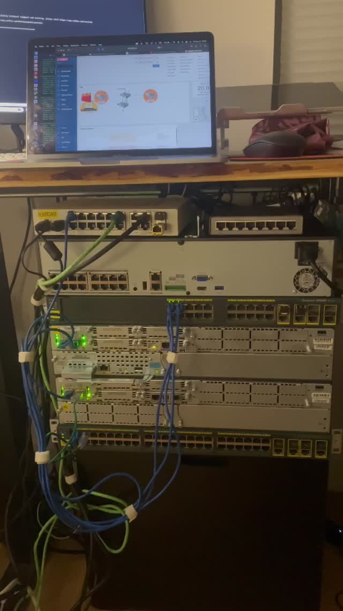

Hands-on, independently built network engineering lab using physical Cisco routers and switches and a FortiGate 80E firewall. The goal is to practice designing, configuring, validating, monitoring, and troubleshooting a small enterprise-style network.

> **Scope:** Personal lab, not a production network or an employer-owned deployment. Configuration examples and architecture descriptions are for demonstration; see [validation notes](docs/architecture-and-validation.md) for details requiring clarification.

# Enterprise Network Engineering Lab

**Cisco Routing & Switching · Fortinet FortiGate · VRRP · VLAN Segmentation · Zabbix**

## Network Device Configurations

Cisco IOS and FortiGate configurations covering VLANs,
802.1Q trunking, VRRP, PAgP EtherChannel, SSH, DHCP, and routing.

[View Network Device Configurations](Network_Lab_Updated_Configs_REVIEW.txt)
## Lab at a glance

| Area | Equipment / technology |
| --- | --- |
| Firewall | Fortinet FortiGate 80E |
| Routing | Cisco 2900-series router (R1), Cisco 2821 (R2) |
| Switching | Two Cisco switches (SW1 and SW2) |
| Segmentation | VLANs 10, 20, 30, 40, 50, 60 and management VLAN 99 |
| Resiliency | VRRP first-hop redundancy with physical failover testing |
| Layer 2 | 802.1Q trunks, STP, PortFast, BPDU Guard |
| Layer 3 / security | Static routing, DHCP, NAT, firewall policies |
| Monitoring | Zabbix with SNMPv2 polling and traps |
| Connected system | Network video recorder (NVR) on camera VLAN |

## Physical lab

[Watch the physical lab walkthrough](media/lab-demo.mp4)

## What I implemented

- Built a segmented Cisco/Fortinet lab with separate networks for users, voice, servers, cameras/NVR, guests, IoT and management.
- Configured VLAN membership and 802.1Q trunks between switching and routing components, plus basic STP edge protections.
- Configured VRRP on two Cisco routers and tested takeover by powering off the primary router.
- Integrated FortiGate routing, NAT, DHCP and security policy functionality.
- Configured SNMPv2 monitoring and Zabbix checks for router/interface status, CPU and VRRP state.
- Investigated configuration faults and documented root causes and fixes.

## Troubleshooting case studies

| Symptom | Root cause | Resolution |
| --- | --- | --- |
| VRRP / management VLAN traffic not passing as expected | SW2 uplink was an access port instead of a trunk | Changed uplink to trunk and aligned native VLAN settings |
| Zabbix could not reach SNMP targets | Missing routed path from monitoring subnet | Added required route and verified with `snmpwalk` |
| R2 could not communicate with firewall | FortiGate interface/IP conflict | Reworked firewall-side interface using VLAN-based addressing |

See [troubleshooting details](docs/troubleshooting.md).

## Validation and design notes

The original lab report describes both a FortiGate gateway role and a VRRP gateway role, and references different server VLAN subnets. These details should be reconciled against the running configurations before publishing a definitive end-to-end topology or claiming all client VLANs fail over through VRRP. The confirmed lab demonstration is VRRP router takeover; end-to-end service continuity requires separate verification.

See [architecture and validation](docs/architecture-and-validation.md).

## About

**Mykyta Mamaiev** · CCNA-certified IT infrastructure professional based in Harrison, New Jersey. Experience supporting enterprise network-connected systems and collaborating with Network Engineering at The New School.

*All content is from my personal lab. No employer configurations, credentials or internal diagrams are included.*
